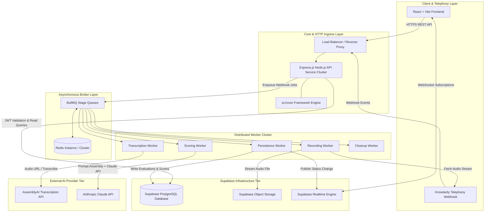
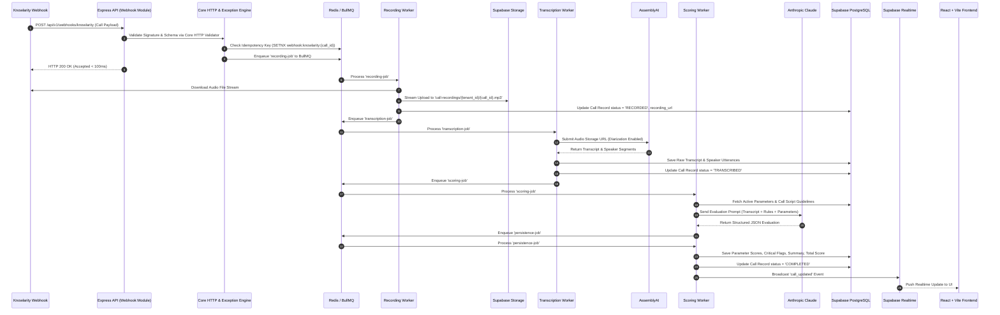

# AuditAI Backend Software Architecture Document

**System Version:** 2.1.0 (Core Infrastructure Refactored)  
**Target Environment:** Node.js, Express.js, TypeScript, Supabase, Redis, BullMQ, AssemblyAI, Anthropic Claude  
**Target Processing Capacity:** 5,000 – 10,000 call audits per day (Burst-tolerant asynchronous pipeline)

---

## 1. Overall System Architecture

The AuditAI backend is designed as an **Enterprise Feature-Based Modular Monolith** powered by a robust **Core Application Engine** (`src/core/`) and an **Asynchronous Event-Driven Queue & Worker Pipeline**.

The core application layer (`src/core/`) provides application bootstrapping, unified configuration management, exception handling, and HTTP infrastructure. Feature modules (`src/modules/`) consume core abstractions while remaining fully self-contained. Asynchronous heavy call processing is decoupled using **Redis** and **BullMQ** job stage queues, with real-time call score updates delivered to the React frontend via **Supabase Realtime**.



---

## 2. End-to-End Request Flow

### 2.1 Telephony Webhook & Call Processing Pipeline Flow



---

## 3. Backend Folder Structure

The application layout incorporates a dedicated `src/core/` infrastructure framework alongside domain-focused feature modules:

```
auditai-backend/
├── src/
│   ├── core/                       # Foundational application engine & framework infrastructure
│   │   ├── bootstrap/              # Initialization & process lifecycle management
│   │   │   ├── app.bootstrap.ts    # Application initialization orchestrator
│   │   │   ├── worker.bootstrap.ts # Background queue worker process manager
│   │   │   └── server.bootstrap.ts # HTTP server listener & graceful shutdown lifecycle
│   │   │
│   │   ├── config/                 # Central configuration engine (Zod validated)
│   │   │   ├── env.config.ts       # Strongly-typed environment variables schema
│   │   │   ├── logger.config.ts    # Structured logging options
│   │   │   ├── redis.config.ts     # Redis & connection pool settings
│   │   │   ├── supabase.config.ts  # Supabase client options
│   │   │   ├── anthropic.config.ts # Anthropic Claude SDK options
│   │   │   ├── assemblyai.config.ts# AssemblyAI STT SDK options
│   │   │   ├── cors.config.ts      # CORS security policies
│   │   │   ├── helmet.config.ts    # Helmet HTTP security header options
│   │   │   ├── queues.config.ts    # BullMQ global defaults
│   │   │   ├── cache.config.ts     # Redis cache TTL settings
│   │   │   └── swagger.config.ts   # OpenAPI documentation configuration
│   │   │
│   │   ├── exceptions/             # Core exception handling hierarchy & global filters
│   │   │   ├── base.exception.ts   # Base application exception class
│   │   │   ├── validation.exception.ts # HTTP 400 validation error
│   │   │   ├── auth.exception.ts   # HTTP 401/403 authentication error
│   │   │   ├── not-found.exception.ts # HTTP 404 resource missing error
│   │   │   ├── provider.exception.ts # HTTP 502 external API error
│   │   │   └── exception.handler.ts # Global Express error handling middleware
│   │   │
│   │   └── http/                   # HTTP core framework infrastructure
│   │       ├── express.app.ts      # Express application setup & middleware pipeline
│   │       ├── base.controller.ts  # Base controller with standard response helpers
│   │       ├── request-context.ts  # AsyncLocalStorage context (X-Request-ID, Tenant ID)
│   │       ├── response.formatter.ts # Uniform API JSON envelope builder
│   │       └── middleware/         # Core HTTP middlewares (Auth, Rate-Limit, Req-ID)
│   │           ├── auth.middleware.ts
│   │           ├── rate-limit.middleware.ts
│   │           └── request-id.middleware.ts
│   │
│   ├── constants/                  # System-wide constant definitions
│   │   ├── api.constants.ts
│   │   ├── queue.constants.ts
│   │   ├── role.constants.ts
│   │   ├── storage.constants.ts
│   │   ├── status.constants.ts
│   │   └── auth.constants.ts
│   │
│   ├── modules/                    # Self-contained feature modules
│   │   ├── auth/
│   │   │   ├── auth.controller.ts
│   │   │   ├── auth.service.ts
│   │   │   ├── auth.repository.ts
│   │   │   ├── auth.routes.ts
│   │   │   ├── auth.validator.ts
│   │   │   ├── auth.types.ts
│   │   │   ├── dto/
│   │   │   ├── interfaces/
│   │   │   └── __tests__/
│   │   │
│   │   ├── clients/
│   │   ├── agents/
│   │   ├── parameters/
│   │   ├── scripts/
│   │   ├── calls/
│   │   ├── dashboard/
│   │   ├── webhook/
│   │   └── payments/
│   │
│   ├── providers/                  # Vendor infrastructure abstractions & prompt templates
│   │   ├── ai/
│   │   │   ├── anthropic.provider.ts
│   │   │   └── prompts/
│   │   │       ├── scoring.prompt.ts
│   │   │       ├── extraction.prompt.ts
│   │   │       └── suggestion.prompt.ts
│   │   ├── transcription/
│   │   │   └── assemblyai.provider.ts
│   │   ├── telephony/
│   │   │   └── knowlarity.provider.ts
│   │   └── storage/
│   │       └── supabase-storage.provider.ts
│   │
│   ├── queues/                     # Message queue producers & job payload contracts
│   │   ├── queue.ts
│   │   ├── queue-manager.ts
│   │   └── jobs/
│   │
│   ├── workers/                    # Isolated background queue consumers
│   │   ├── recording.worker.ts
│   │   ├── transcription.worker.ts
│   │   ├── scoring.worker.ts
│   │   ├── persistence.worker.ts
│   │   └── cleanup.worker.ts
│   │
│   ├── database/                   # Infrastructure database scripts & migrations
│   │   ├── migrations/
│   │   ├── seed/
│   │   └── supabase/
│   │
│   ├── routes/
│   │   └── index.ts                # Central route index registering feature routes
│   │
│   ├── common/                     # Cross-cutting domain utilities & helpers
│   │   ├── helpers/
│   │   └── types/
│   │
│   └── index.ts                    # Application process entrypoint
```

---

## 4. Core Architecture (`src/core/`)

The `core/` package forms the operational backbone of the backend engine:

### 4.1 `core/bootstrap/`
- **`app.bootstrap.ts`**: Orchestrates application startup, validates configurations, initializes database connection pools, and mounts core middlewares.
- **`server.bootstrap.ts`**: Handles HTTP server lifecycle, socket binding, and graceful shutdown signal traps (`SIGTERM`, `SIGINT`).
- **`worker.bootstrap.ts`**: Initializes BullMQ background worker listeners and registers process teardown handlers.

### 4.2 `core/config/`
Houses all strongly-typed configuration modules (validated via Zod):
- `env.config.ts`, `logger.config.ts`, `redis.config.ts`, `supabase.config.ts`, `anthropic.config.ts`, `assemblyai.config.ts`, `cors.config.ts`, `helmet.config.ts`, `queues.config.ts`, `cache.config.ts`, `swagger.config.ts`.

### 4.3 `core/exceptions/`
Provides a unified exception hierarchy and global error handling filter:
- `base.exception.ts` (Base class for all application errors).
- `validation.exception.ts`, `auth.exception.ts`, `not-found.exception.ts`, `provider.exception.ts`.
- `exception.handler.ts` (Global Express middleware that intercepts all unhandled errors and produces standard JSON error envelopes).

### 4.4 `core/http/`
Houses HTTP runtime infrastructure:
- `express.app.ts` (Express engine instance factory).
- `base.controller.ts` (Abstract controller providing helper methods for standard success/error responses).
- `request-context.ts` (Uses Node.js `AsyncLocalStorage` to propagate correlation IDs (`X-Request-ID`) and authenticated tenant context across async call chains).
- `response.formatter.ts` (Formats all HTTP output into standardized JSON envelopes).

---

## 5. Module Responsibilities

Feature modules (`src/modules/`) extend core abstractions while preserving total feature self-containment:

| Module | Core Responsibility | Key Operations |
| :--- | :--- | :--- |
| **`auth`** | User Identity & RBAC | Extends `core/exceptions/auth.exception.ts`, handles JWT auth & RBAC permissions. |
| **`clients`** | Multi-Tenant Management | Manages tenant profiles, API keys, webhook signing secrets, and tenant configuration. |
| **`agents`** | Agent Roster Management | Tracks call center agents, team assignments, assigned QA scripts, and individual agent quality metrics. |
| **`parameters`** | Audit Parameter Configuration | Defines call evaluation criteria (e.g., Greeting, Verification, Sentiment, Compliance) and scoring weights. |
| **`scripts`** | Call Script Management | Manages reference call scripts, SOP guidelines, and compliance checklists. |
| **`calls`** | Call History & Override | Provides call query APIs, detailed transcript views, parameter score breakdowns, and manual QA overrides. |
| **`dashboard`** | Analytics & Reporting | Computes aggregate KPIs (Average Score, CSAT proxy, Compliance Violations, Agent Leaderboard). |
| **`webhook`** | Telephony Ingress | Authenticates incoming Knowlarity signatures, validates payload schemas, checks idempotency, enqueues jobs. |
| **`payments`** | Usage & Metering Sync | Tracks processed call audit minutes per tenant, enforces plan limits, and syncs subscription state. |

---

## 6. API Layer Design

### 6.1 Express Lifecycle & Controller Pattern
All module controllers extend `BaseController` from `src/core/http/base.controller.ts`, guaranteeing consistent response formatting and exception propagation to `exception.handler.ts`.

---

## 7. Business Service & Repository Layer

- Services (`modules/<module>/<module>.service.ts`) execute pure domain business logic.
- Repositories (`modules/<module>/<module>.repository.ts`) encapsulate Supabase PostgreSQL database queries, enforcing multi-tenant isolation (`.eq('tenant_id', tenantId)`).

---

## 8. Queue & Worker Architecture

Background workers run as separate processes bootstrapped by `core/bootstrap/worker.bootstrap.ts`.
Prompt templates are imported from `providers/ai/prompts/` rather than hardcoded in workers.

---

## 9. Complete Directory Structure

```
auditai-backend/
├── src/
│   ├── core/
│   │   ├── bootstrap/
│   │   │   ├── app.bootstrap.ts
│   │   │   ├── worker.bootstrap.ts
│   │   │   └── server.bootstrap.ts
│   │   │
│   │   ├── config/
│   │   │   ├── env.config.ts
│   │   │   ├── logger.config.ts
│   │   │   ├── redis.config.ts
│   │   │   ├── supabase.config.ts
│   │   │   ├── anthropic.config.ts
│   │   │   ├── assemblyai.config.ts
│   │   │   ├── cors.config.ts
│   │   │   ├── helmet.config.ts
│   │   │   ├── queues.config.ts
│   │   │   ├── cache.config.ts
│   │   │   └── swagger.config.ts
│   │   │
│   │   ├── exceptions/
│   │   │   ├── base.exception.ts
│   │   │   ├── validation.exception.ts
│   │   │   ├── auth.exception.ts
│   │   │   ├── not-found.exception.ts
│   │   │   ├── provider.exception.ts
│   │   │   └── exception.handler.ts
│   │   │
│   │   └── http/
│   │       ├── express.app.ts
│   │       ├── base.controller.ts
│   │       ├── request-context.ts
│   │       ├── response.formatter.ts
│   │       └── middleware/
│   │           ├── auth.middleware.ts
│   │           ├── rate-limit.middleware.ts
│   │           └── request-id.middleware.ts
│   │
│   ├── constants/
│   │   ├── api.constants.ts
│   │   ├── queue.constants.ts
│   │   ├── role.constants.ts
│   │   ├── storage.constants.ts
│   │   ├── status.constants.ts
│   │   └── auth.constants.ts
│   │
│   ├── modules/
│   │   ├── auth/
│   │   ├── clients/
│   │   ├── agents/
│   │   ├── parameters/
│   │   ├── scripts/
│   │   ├── calls/
│   │   ├── dashboard/
│   │   ├── webhook/
│   │   └── payments/
│   │
│   ├── providers/
│   │   ├── ai/
│   │   │   ├── anthropic.provider.ts
│   │   │   └── prompts/
│   │   │       ├── scoring.prompt.ts
│   │   │       ├── extraction.prompt.ts
│   │   │       └── suggestion.prompt.ts
│   │   ├── transcription/
│   │   │   └── assemblyai.provider.ts
│   │   ├── telephony/
│   │   │   └── knowlarity.provider.ts
│   │   └── storage/
│   │       └── supabase-storage.provider.ts
│   │
│   ├── queues/
│   │   ├── queue.ts
│   │   ├── queue-manager.ts
│   │   └── jobs/
│   │
│   ├── workers/
│   │   ├── recording.worker.ts
│   │   ├── transcription.worker.ts
│   │   ├── scoring.worker.ts
│   │   ├── persistence.worker.ts
│   │   └── cleanup.worker.ts
│   │
│   ├── database/
│   │   ├── migrations/
│   │   ├── seed/
│   │   └── supabase/
│   │
│   ├── routes/
│   │   └── index.ts
│   │
│   ├── common/
│   │   ├── helpers/
│   │   └── types/
│   │
│   └── index.ts
│
├── tests/
│   ├── integration/
│   └── e2e/
│
├── docs/
├── scripts/
├── docker/
├── .github/workflows/
├── .env / .env.example / .gitignore / .dockerignore
├── tsconfig.json / package.json / README.md / LICENSE
```
